# Field Control Technology User's Guide

Fields determine many of the physical forces of the Starbound universe, such as atmosphere, gravity, and shielding. Field control technology involves two interrelated concepts: field tuning, and field manipulation. Every block within every world is aligned to a field. Using a field tuner, you can re-tune blocks to a different field. Using a field control console, you can manipulate the physical properties of a field, and all of the blocks aligned with it.

In short, this mod allows you to take control of the basic physics of worlds. Some applications include: protecting locked rooms in your base, protecting bases from meteors, building bases in asteroid belts with air and gravity, and so forth.

Manipulating the physical forces of the universe can be complicated, so please read this guide thoroughly before doing so.

## Field Control Technology: A Primer

This mod provides a number of items for controlling the forces of the Starbound universe:

* Field Control Console
* Portable Field Tuner
* Field Tuner XL and Field Tuning Markers
* Ship Control Console
* enhanced Space Station Console\*

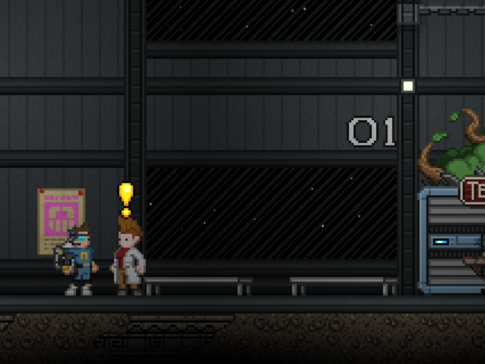

*As of v3.0.0*, field control technology recipes must be learned from two quests, available from the wandering human scientist at the Outpost near Terramart. (Note: Mods may change this NPC's appearance, but they should still be a scientist at the Outpost.) Elliot's tech challenge quest line is a prerequisite for these quests. If you used earlier versions of this mod, some of your characters may already know the recipes, but will still have to complete the quests to learn the new recipes introduced in v3.0.0.

### Field Control Console

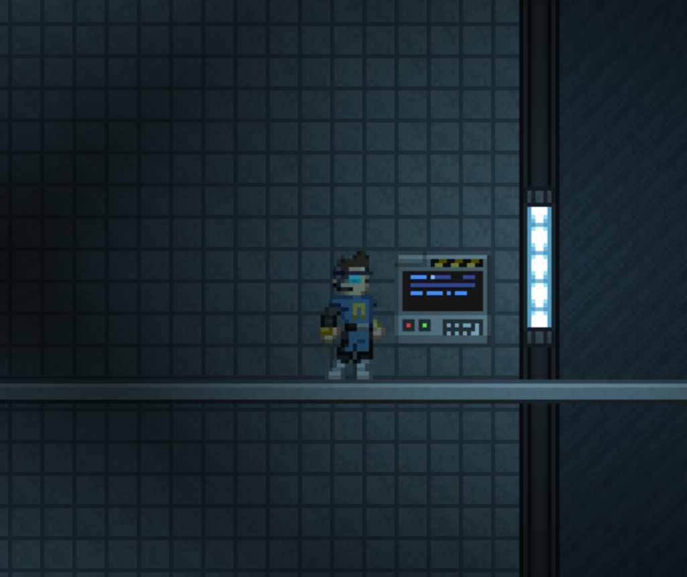

Fields are identified by their field frequency (0-65535). Placing and interacting with a **field control console** allows the player to align the console to a specific field frequency and activate it. The field control console chooses as its default frequency that of the field to which the center block behind the console is aligned; if that is not a valid frequency, a random frequency is chosen. An alternative field can be chosen by entering its field frequency at the prompt. Activation of a field control console automatically tunes all of the blocks behind the console to the chosen field.

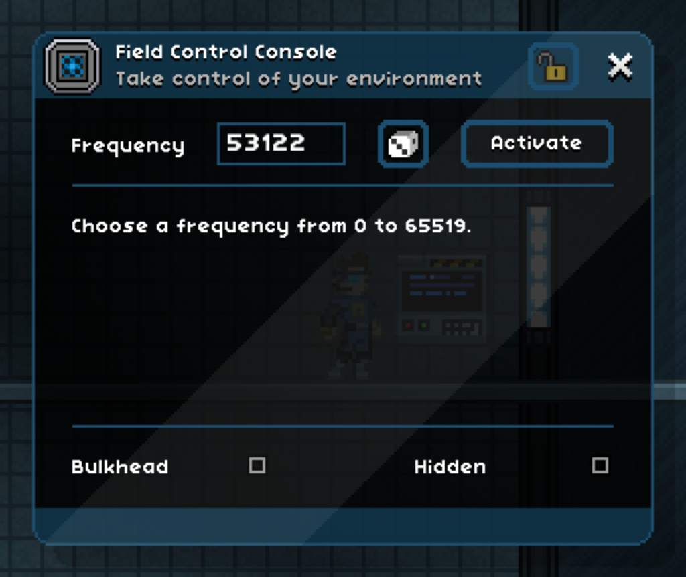

On any given world, many field control consoles may be placed, but only one console can be activated for each field. Furthermore, a field control console cannot be activated when aligned to a field shielded by anything not provided by this mod. For example, it cannot be activated when aligned to the field shielded by a Hylotl underwater shield generator, or to the field shielded by a personal space station's external shields. Additionally, to avoid potentially world-breaking effects, field control consoles cannot be activated when aligned to frequencies above 65519.

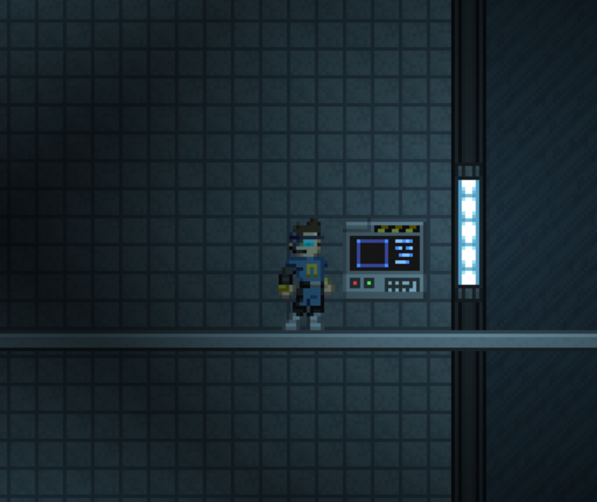

Once a valid frequency has been chosen and the field control console activated, the console's interface will enable the manipulation of gravity, shielding, and breathable atmosphere for that field. The shielding and atmosphere controls are simple on/off check boxes.

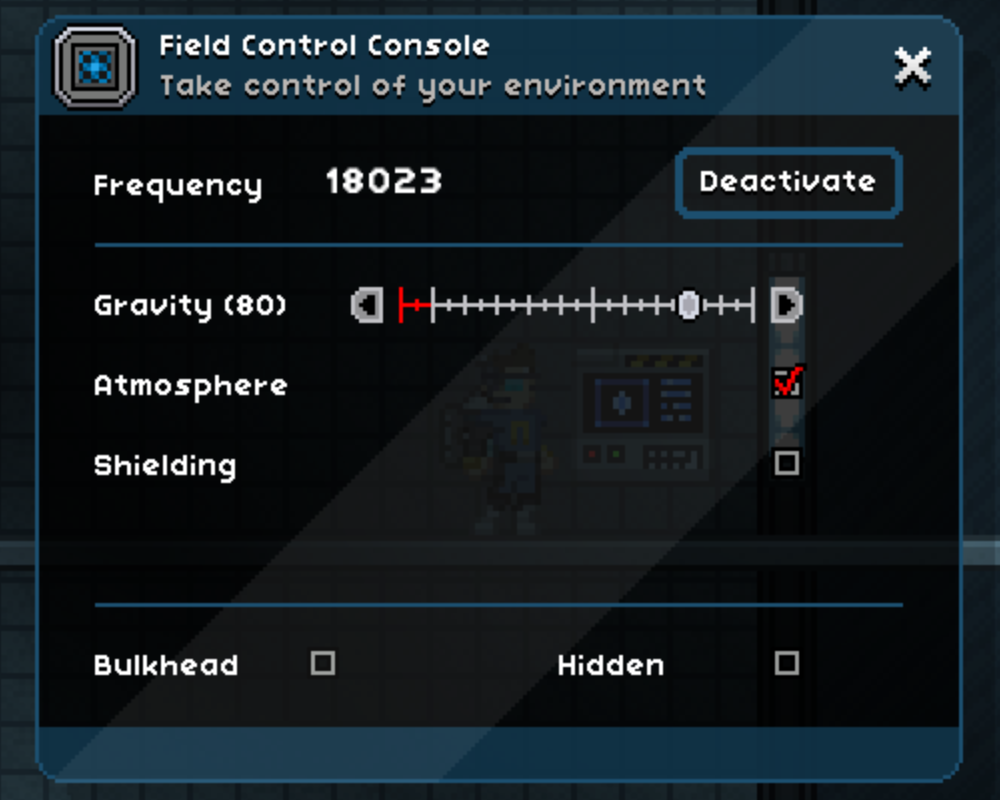

Target gravity is controlled by a slider. When the console is activated, the slider defaults to the original gravity of the field. If set to 0, it will result in weightlessness. It may be set to negative values, although extreme caution is recommended as the player may float away helplessly without being able to shut off the effect. When the gravity override control is checked, the field's gravity is set to the target gravity; when it is not checked, the field's gravity returns to its default.

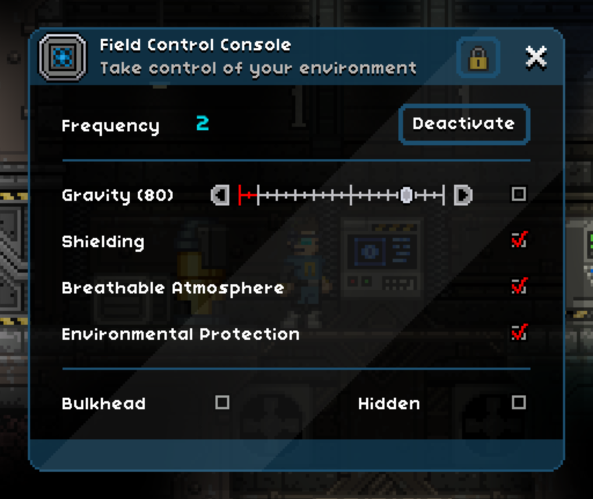

If placed on a world with environmental hazards (e.g., deadly [radiation](https://starbounder.org/Deadly_Radiation), [cold](https://starbounder.org/Deadly_Chill), or [heat](https://starbounder.org/Deadly_Heat)), the field control console will offer an additional setting: environmental protection. Toggling this option on will protect players and mechs from these hazards while they are within the field controlled by the console.

*To enable this feature, either [Belter Dungeons](https://community.playstarbound.com/resources/belter-dungeons.6357/) or [No Belter Dungeons](https://community.playstarbound.com/resources/no-belter-dungeons.6358/) v2.2.0 or newer must be installed. To enable mech protection, both [Mech Compatibility Core](https://steamcommunity.com/sharedfiles/filedetails/?id=3371002682) and [Mech Compatibility Loader](https://steamcommunity.com/sharedfiles/filedetails/?id=3371011064) must also be installed.*

Field control consoles can only protect against known environmental hazards. Hazards added by mods will require extensions. Currently available extensions are:
* [Arcana Compatibility](https://community.playstarbound.com/resources/field-control-technology-arcana-compatibility.6405/)
* [Frackin' Universe Compatibility](https://community.playstarbound.com/resources/field-control-technology-frackin-universe-compatibility.6406/)

Deactivation of a field control console will reset the gravity, shielding, atmosphere, and environmental protection for its aligned field to the original values that were present at the console at the moment it was activated. Deactivation is automatic if the field control console is broken.

*As of v3.0.0*, field control consoles can be locked to prevent unauthorized access, and support wiring for remote control. Please see the [access control section](#field-control-console-access-control) and the [wiring section](#field-control-console-wiring) for detailed instructions.

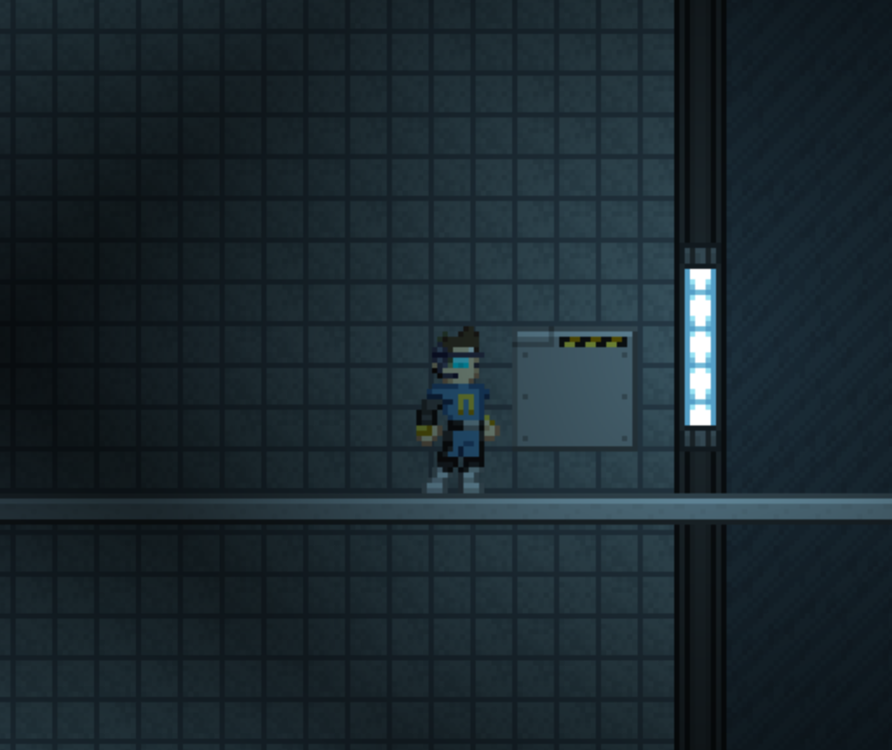

Field console consoles contain lit electronics and provide a small amount of light. You can activate bulkhead mode to hide the console behind a bulkhead, in which case no lighting is visible. Alternatively, the console can be hidden entirely within the background wall.

After learning the recipe, the field control console may be crafted at the **wiring station**, in the **mechanics** tab.

### Portable Field Tuner

The main device for tuning blocks to fields is the **portable field tuner**. Portable field tuners allow fine-grained control of the shape of fields, but are limited to about the same range as a fully upgraded matter manipulator.

When you first equip a portable field tuner, it will not be aligned to any field. Right click on a block to align the portable field tuner to the field to which that block is aligned. Under most circumstances, this will activate the field grid, a 5x5 grid showing the fields around the pointer. A green grid square indicates the block behind it is aligned to the same field as the portable field tuner. A blue grid square indicates that the block behind it is aligned to a different field, but is eligible to be re-tuned. A red grid square indicates that the block behind it is shielded, and therefore cannot be re-tuned at this time.

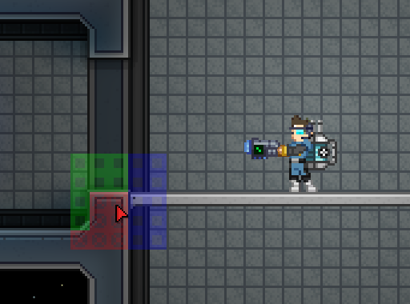

Once the field grid is active, left clicking will begin field tuning, and any blue grid squares will turn green, indicating that the blocks underneath have been re-tuned. If you hold shift, the field grid collapses to a single square, allowing fine-grained tuning of a single block at a time.

Any time you right click on a block, the portable field tuner is re-aligned to the field to which that block is aligned, and the coloration of the field grid will change accordingly. Note, the portable field tuner cannot be aligned to certain fields, in particular, it cannot align to any fields shielded by anything not provided by this mod. For example, it cannot be aligned to the field shielded by a Hylotl underwater shield generator, or to the fields shielded by a space station's external shields. If you right click on a block aligned to such reserved field frequencies, the portable field tuner will produce a warning sound, and the field grid will deactivate.

Field tuning is specific to each world. Any time you travel to another world, the portable field tuner will be reset.

After learning the recipe, the portable field tuner may be crafted at the **agricultural station**, in the **survival** tab.

### Field Tuner XL and Field Tuning Markers

The portable field tuner is a tool for fine-grained field tuning. However, manually tuning a large area is tedious. The **field tuner XL** is the larger cousin of the portable field tuner. Place it within an area you wish to tune, and then place **field tuning markers** around it such that they form a rectangle bounding the area you wish to tune. Wire the field tuner XL directly to the field tuning markers; the markers must be wired directly to the field tuner XL or they will not be used.

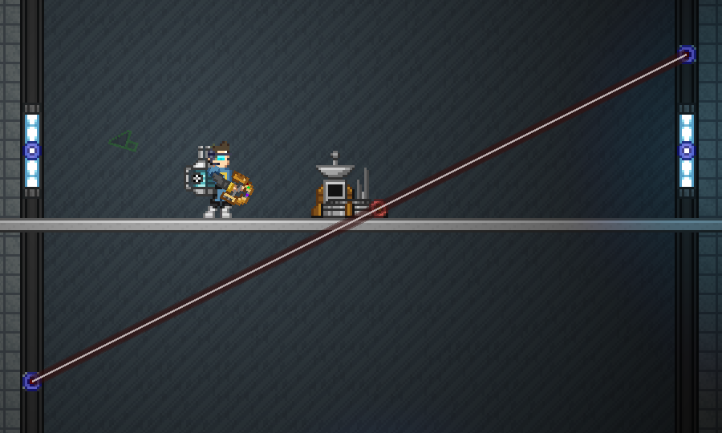

Interacting with the field tuner XL opens its activation menu. The field tuner XL chooses as its default frequency that of the field to which the blocks behind the field tuner XL are aligned; if that is not a valid frequency, a random frequency is chosen. As an alternative, you may enter any valid frequency; a good choice is the frequency to which one of your field control consoles is aligned. The same rules that apply to the portable field tuner also apply to the field tuner XL; an error message will be generated if the frequency to which it is set is reserved.

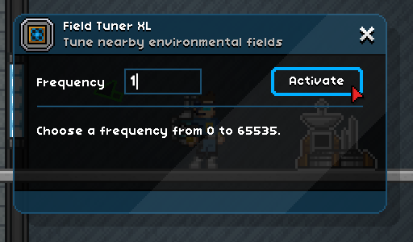

Once a valid frequency has been chosen, activating the field tuner XL will begin tuning the blocks within its bounding rectangle. While tuning, the field tuner XL is not interactive and its antenna extends and rotates. The antenna retracts once it has completed tuning. After the field tuner XL has completed tuning, there is no reason to leave it installed in the world. You can take it and the field tuning markers and reuse them elsewhere.

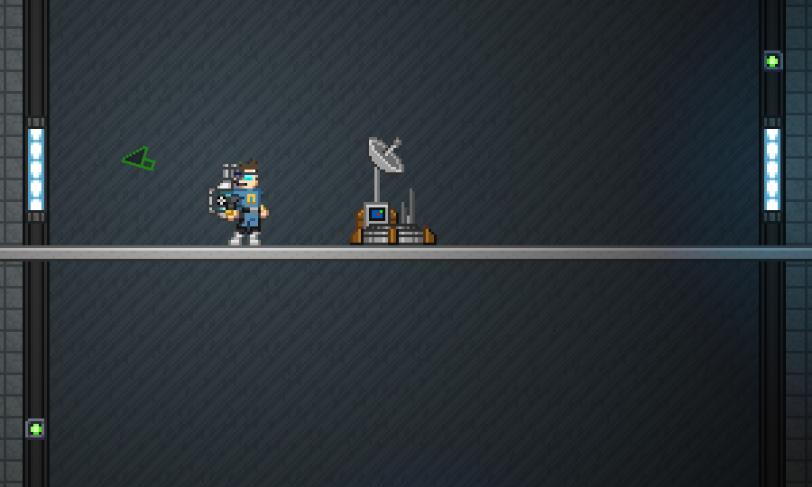

The field tuner XL can tune several thousand blocks per second, and has a two second warmup/cooldown cycle. The maximum length of wiring connections (not in admin mode) produces an upper bound of approximately 36000 tiles within a bounding box, so a very large tuning job can be expected to take approximately ten seconds. Like the portable field tuner, the field tuner XL cannot re-tune shielded blocks; any such blocks encountered during tuning will be ignored.

After learning the recipes, the field tuner XL and field tuning markers may be crafted at the **wiring station**, in the **mechanics** tab.

## Caveat: Build-Tune-Shield Loop

One hard-coded aspect of Starbound is that, any time the player places a material tile into a block (e.g., placing a tile using the Matter Manipulator) or adds a matmod to a block (e.g., tilling soil or placing grass seed), the core engine changes the field frequency of that block to 65532. Likewise, any time the player removes a material tile from a block (e.g., break a tile using the Matter Manipulator) or removes a matmod from a block (e.g., removing tilling from soil), the core engine changes the field frequency of that block to 65531. This is hard-coded into the game and there is nothing modders can do to prevent it. Note that field frequencies are not changed by adding or removing objects such as furniture or doors, but only by adding or removing material tiles or matmods.

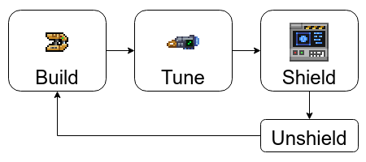

This effect will not affect you as long as you activate shielding on your fields. However, if you disable shielding and add or remove tiles, you must re-tune those tiles afterwards so that they are re-aligned with your desired field. Remember the build-tune-shield loop. Take care, especially when rebuilding areas in zero atmosphere/gravity worlds such as asteroid belts; you may experience sudden loss of atmosphere and/or gravity while rebuilding.

## Field Control Console: Access Control

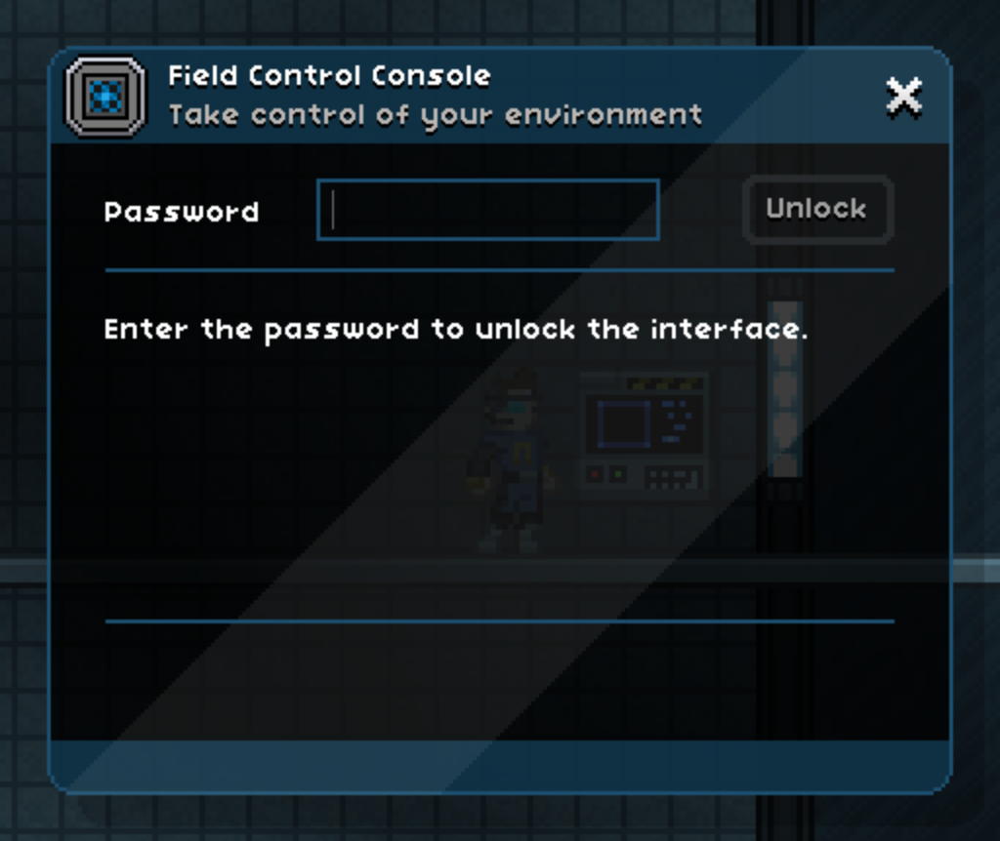

Field control consoles can be locked to prevent unauthorized access. If a console has been locked, when a player interacts with it, the first screen they see will be the lock screen. Nothing can be done on the console until the correct password is entered. Once the password has been entered, the field control console interface is available as normal, until the player leaves the console.

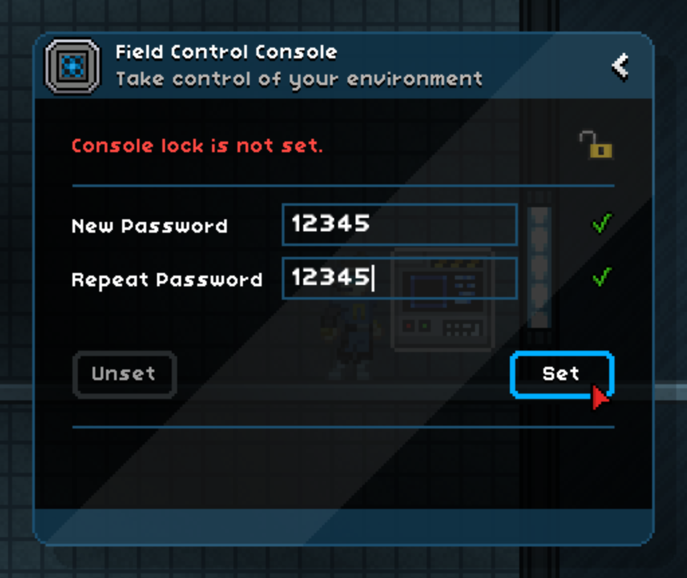

The **Lock** button in the title bar, just to the left of the **Close** button, displays a locked lock if a password has been set, and an unlocked lock otherwise. Clicking the lock button displays the lock configuration screen. Enter the same password in both password fields and click the **Set** button to set or change the password.

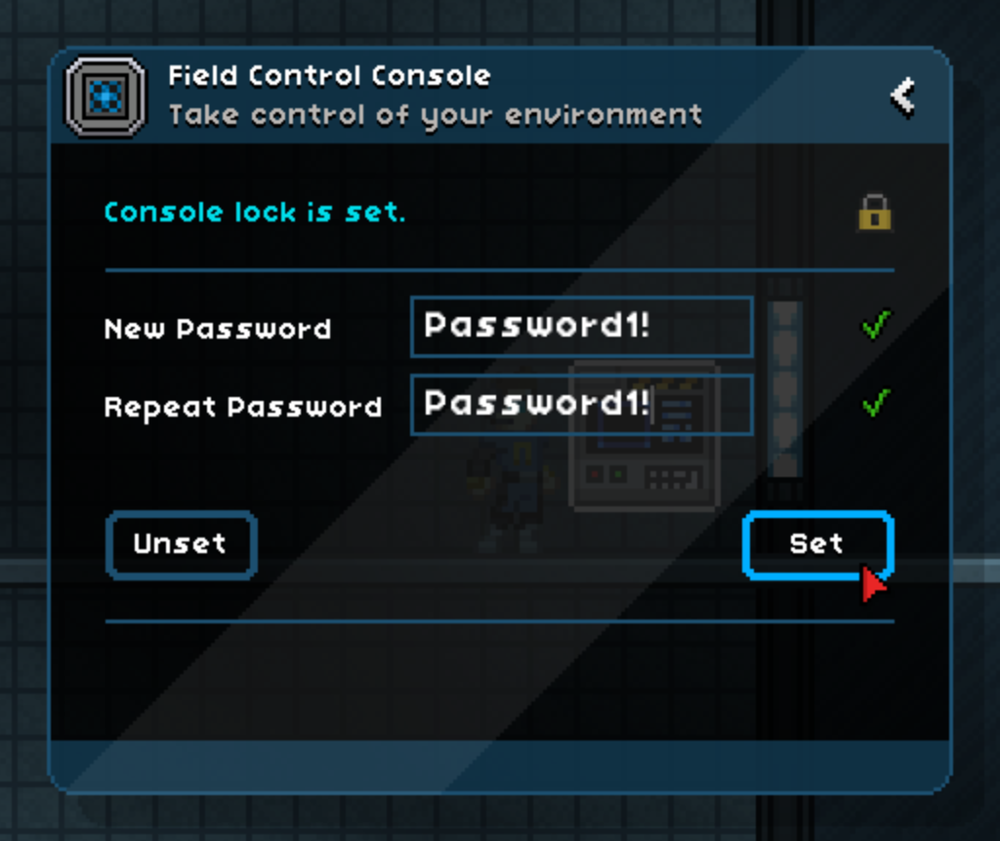

If a password has already been set, clicking the **Unset** button clears the password, rendering the field control console available to all players once again. To exit the lock configuration screen without making any changes, simply click the **Back** button in the upper right corner.

Note that if shielding is down, any player may break a field control console and replace it, effectively circumventing the lock screen. Access control only makes sense in shielded environments.

## Field Control Console: Wiring

Field control consoles provide four input nodes and five output nodes, allowing for extensive remote control of their capabilities. If a field control console is not activated, then all of its input nodes are ignored, and all of its output nodes are false.

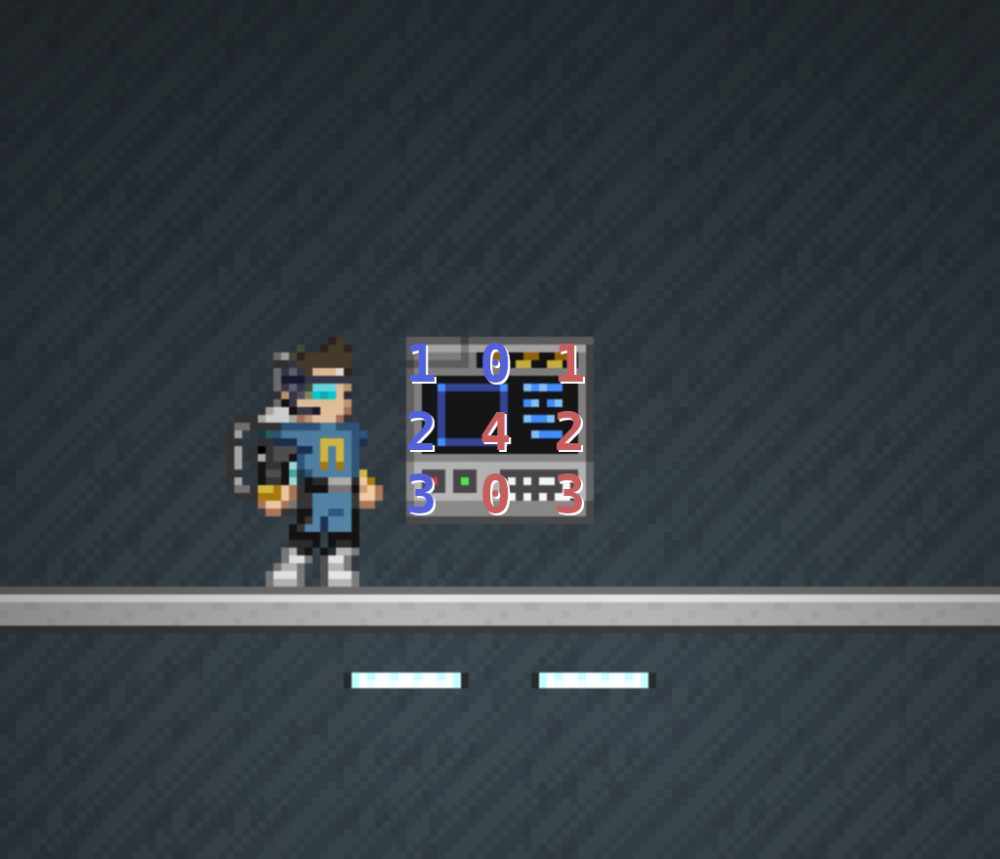

The numbers shown in the diagram correspond to the node's index numbers.

If an input node is connected to a field control console, the corresponding control in the console's interface is locked to the level of the node. The input nodes (shown in blue in the diagram) are as follows:
<ol start="0">
<li><b>Gravity Override</b></li>
<li><b>Shielding</b></li>
<li><b>Breathable Atmosphere</b></li>
<li><b>Environmental Protection</b>: If Belter Dungeons is not installed, this node is ignored.</li>
</ol>

Take care when connecting or disconnecting nodes. When a node is connected, the state of its corresponding functionality is set immediately to the node's level. Likewise, when a node is disconnected, the state of its corresponding functionality is set to off.

The output nodes (shown in red in the diagram) are as follows:
<ol start="0">
<li><b>Gravity Override</b></li>
<li><b>Shielding</b></li>
<li><b>Breathable Atmosphere</b></li>
<li><b>Environmental Protection</b>: True if no environmental hazards are detected or if protection is enabled for all such hazards, and false otherwise.</li>
<li><b>Activation</b>: True if the field control console has been activated, and false otherwise.</li>
</ol>

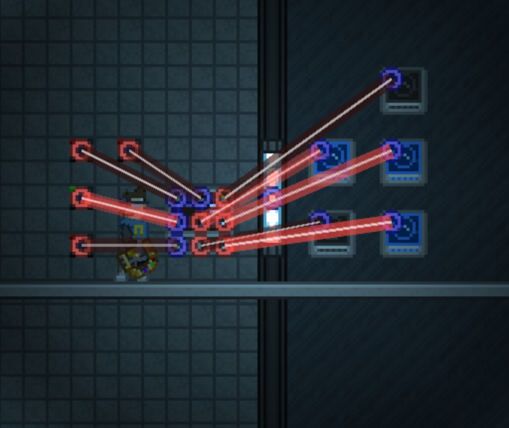

When a field control console is wired, the toggle switches in its interface are visible but disabled, indicating that those controls can only be altered by the input wiring.

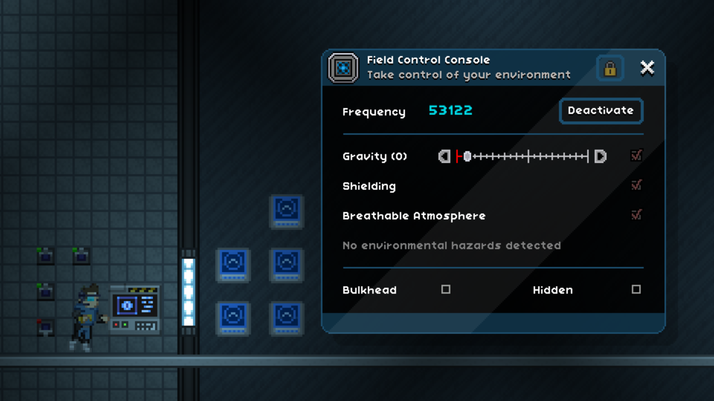

## Special-Case Field Control

*New as of v3.0.0*

Some additional objects are available to handle special cases of field control on specific types of worlds.

### Ship Control Console

Seven racially-themed **ship control console** objects are available. A ship control console must be placed in a player ship. Only one console can be placed in each player ship; if additional consoles are placed, they will be nonfunctional. The ship control console provides functionality similar to that of the field control console, but applied simultaneously to the multiple fields found by default on player ships.

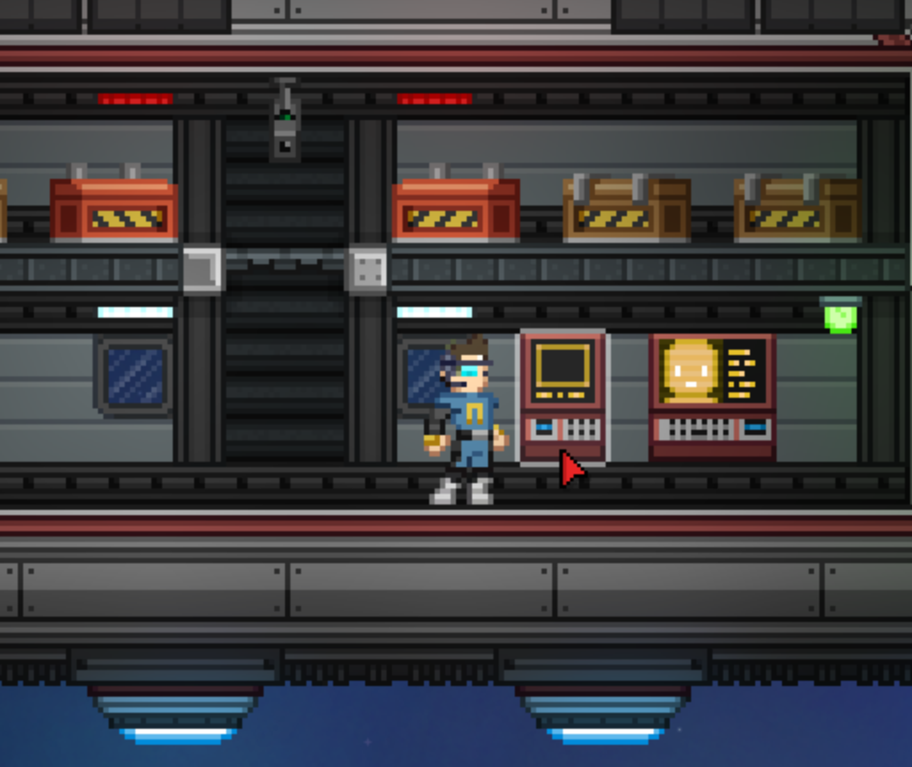

Differences from the field control console:
* Gravity cannot be negated, and the gravity control is always active.
* Controls only the default fields in the ship; cannot be registered to arbitrary fields.
* Three input nodes: shielding, atmosphere, and hazard protection.
* Three output nodes: shielding, atmosphere, and hazard protection.

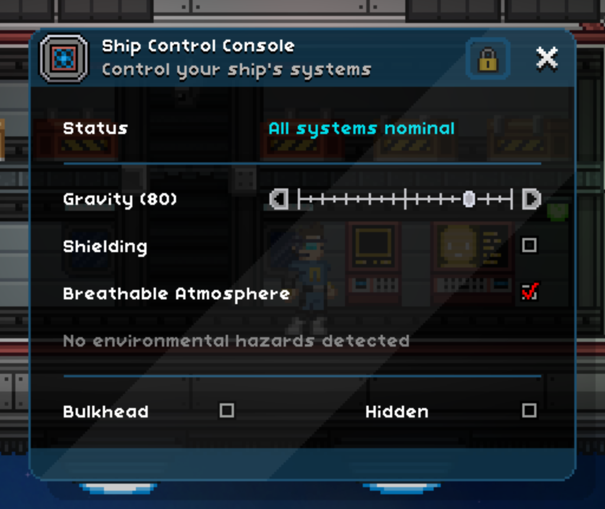

After learning the recipe, the ship control console may be crafted at the **wiring station**, in the **mechanics** tab.

### Space Station Console

The space station console, also known as the player station console, is found as an unbreakable object on every player space station. In the base game, this console controls only the gravity on the space station. It also enables the user to hide the space station extension slots.

If *Field Control Technology - Space Control Console* is installed in addition to *Field Control Technology* v3.0.0 or later, this console will be upgraded automatically to provide functionality similar to that of the field control console, but applied simultaneously to the multiple fields found by default on player space stations.

Virtually all users who install *Field Control Technology* will also want *Field Control Technology - Space Control Console*. It is distributed as a separate mod only due to its increased risk of mod conflicts. (The author is not aware of any actual mod conflicts at this time.)

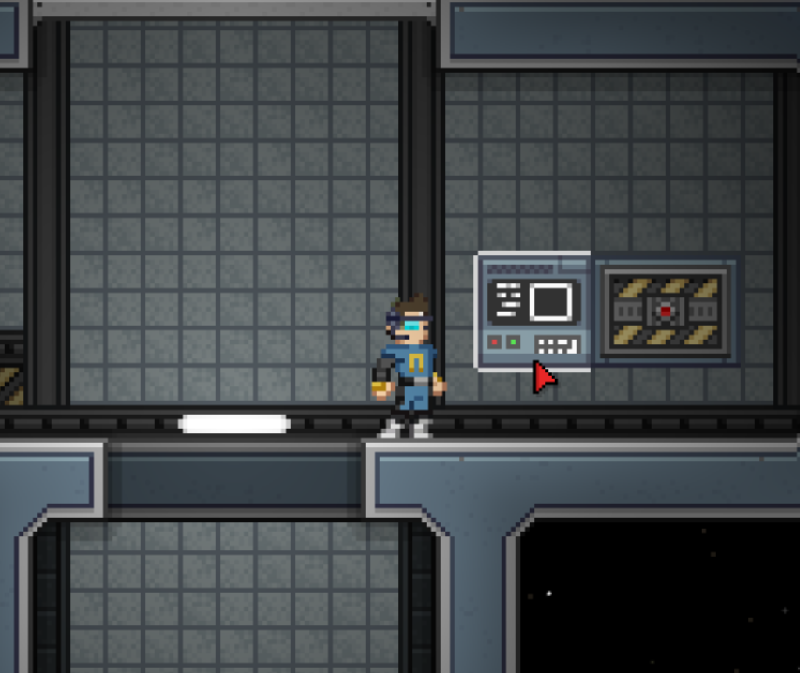

Differences from the field control console:
* Gravity cannot be negated, and the gravity control is always active.
* Controls only the default fields in the space station; cannot be registered to arbitrary fields.
* Cannot be hidden or disguised as a bulkhead.
* Can control space station expansion slot visibility.
* No input or output wiring nodes.

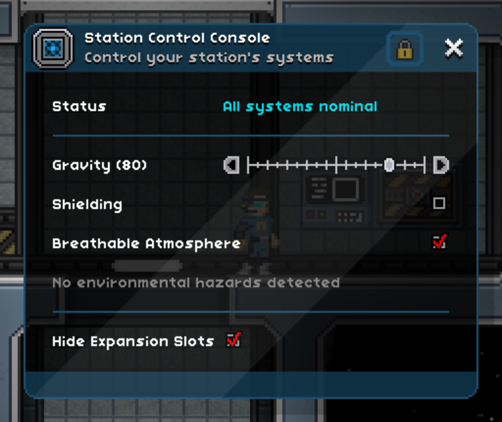

The space station console cannot be crafted or placed. It is always available on player space stations, and will provide field control functionality as long as *Field Control Technology - Space Control Console* is installed. **Players must not use admin commands to spawn a space station console; placing two space station consoles in one space station will corrupt the world.**

## Obsolete Objects

Newer versions of this mod have obsoleted some objects that were introduced in earlier versions. These objects will remain in the assets for backward compatibility, but users should replace them at their earliest convenience.

### Ship Shield Switch

*Obsoleted as of v3.0.0*

The seven racially-themed **ship shield switch** objects provide simultaneous shield toggling for the multiple fields found by default in a player ship. As of v3.0.0, the seven racially-themed ship control console objects are their intended replacements, but because the object geometry differs (functionality requires the consoles to be 2x3 blocks, while the switches are 2x2 blocks) these objects must be replaced by users manually. A ship shield switch will continue to function as long as no ship control console is placed on the ship; it will deactivate itself automatically when a ship control console is placed.

Ship control consoles should be preferred in place of ship shield switches.

A ship shield switch must be placed in a player ship. Only one may be placed in a ship; if additional switches are placed they will be nonfunctional. The switch controls only the default fields in the player ship. It does not control additional fields that the user may create, e.g., by using a field control console.

Ship shield switches are no longer craftable.

### Station Shield Switch

*Deprecated as of v3.0.0*

The **station shield switch** object provides simultaneous shield toggling for the multiple fields found by default in a player space station. If *Field Control Technology - Space Control Console* is installed, all station shield switches will be converted automatically into nonfunctional decorative objects.

Station shield switches should be used only if the user cannot install *Field Control Technology - Space Control Console*.

A station shield switch must be placed in a player space station. Only one may be placed in a station; if additional switches are placed they will be nonfunctional. The switch controls only the default fields in the player space station. It does not control additional fields that the user may create, e.g., by using a field control console.

After learning the recipe, the station shield switch may be crafted at the **wiring station**, in the **mechanics** tab, as long as *Field Control Technology - Space Control Console* is not installed. If that mod is installed, the switch will no longer be craftable.

## FAQ

### Q: How is this different from Pilch's Field Generators?

**A:** This mod started out as an idea to improve Pilch's Field Generators to allow players to shield any shape. However, Pilch was no longer active in Starbound, so I built a new mod from scratch. Each of Pilch's field generators allows you to shield a rectangular-shaped area, and the regions protected by different field generators cannot overlap. If you want to shield a more complex shape, you'd need to set up multiple field generators, potentially many of them. My field control consoles and field tuners allow players to define shielded regions of any size or shape, and also to provide environmental protection in those regions. Despite both mods offering similar functionality, they both can be installed together, although there is no reason to use Pilch's Field Generators for new builds.

### Q: Isn't field frequency just a fancy way of saying dungeonid?

**A:** Yes. Internally, Starbound has the concept of a "dungeon" as a defined region in a world, identified by a numeric "dungeonid", and with properties such as gravity, air, and shielding. The structures that spawn into worlds are referred to by players as dungeons, but they're not exactly the same thing. To avoid confusion, as well as avoid breaking the fourth wall, I refer to the internal "dungeon" concept as a "field", and "dungeonid" as "field frequency".

### Q: The portable field tuner can only align to field frequencies that already exist in a world. How can I create a new field?

**A:** You can place a field control console in the world and align it a new field frequency. Once you've activated the console, equip the portable field tuner and right-click the area behind the console to align the tuner to the new frequency.

### Q: Why can't I align the field control console to high field frequencies?

**A:** Certain field frequencies have special meanings to Starbound. These frequencies exist above 65519. Enabling you to alter these fields could have game-breaking effects. The goal of this mod is to enable the creation and protection of interesting bases and dungeons, not to enable god-level control of worlds. If you want that, there are always admin commands.

### Q: Why can't I re-tune shielded blocks?

**A:** If you could re-tune shielded blocks, it would be trivial to unshield any block simply by re-tuning it to a non-shielded frequency. Anyone could destroy your "shielded" base with nothing more than a portable field tuner. If you want to re-tune blocks, you must drop the shielding first.

### Q: I built a base on a mountain of loose silt and shielded it, but the base collapsed anyway. Why wasn't it protected?

**A:** Gravity-affected materials are controlled by the core engine and their movement can't be prevented, even by shielding. Furthermore, when gravity-affected materials move, that counts as adding or removing a material, so the core engine changes the field frequency of the affected blocks, which causes loss of shielding. (See [Caveat: Build-Tune-Shield Loop](#caveat-build-tine-shield-loop).) Unfortunately, there is nothing modders can do to prevent this, and as such, I do not recommend building bases on gravity-affected materials.

### Q: Help, I've locked myself inside a shielded room!

**A:** That wasn't smart. Time to use admin commands to disable shielding. If you don't have admin privileges, then you'll need to beg someone who does to help you. If this is really a concern, you may want to equip your characters with [emergency teleporters](https://community.playstarbound.com/resources/emergency-teleporter.5745/).

### Q: Help, I've set a password on my field control console and I can't remember it!

**A:** If shielding is down, you can break the field control console and then replace it. If shielding is up, see the answer to the previous question.

### Q: I drowned/suffocated in my base while breathable atmosphere was active. Why?

**A:** In the base game, there are three ways to die by asphyxiation: no atmosphere; drowning; and being trapped behind foreground blocks, as by a landslide of gravity-affected materials. The field control console can protect you from "no atmosphere", but by design, it does not protect you from the other two. You'll still need a breathing apparatus or tech for those scenarios.

### Q: My field control console says "Atmospheric oxygen unavailable". What does that mean?

**A:** In addition to the base game's "no atmosphere", Frackin' Universe provides an `fu_nooxygen` status effect that exists in some worlds. Unfortunately, the blocking stat for this effect is the same as for drowning or being trapped behind foreground blocks, which means that protecting players against it would also protect them from all forms of asphyxiation. I don't want to do that, so I've decided that field control consoles cannot protect players from the `fu_nooxygen` status effect, and have locked out the breathable atmosphere control when it is present. You'll have to use a breathing apparatus or tech to protect you on these worlds.

### Q: My field control console says "Environmental protection module unavailable". What does that mean?

**A:** Environmental protection requires either *Belter Dungeons* or *No Belter Dungeons* to be installed. If neither is installed, and if at least one environmental hazard is detected, then the field control console will display this warning.

### Q: I was poisoned in my base even though environmental protection was active. Why?

**A:** Field control consoles with active environmental protection protect only against persistent environmental hazards, such as deadly radiation, cold, or heat. They do not protect against weather effects or elemental attacks. Likewise, if you live on a world with meteor showers, while a field control console with active shielding will protect *your base* from meteor strikes, it won't protect *you*, if you happen to get hit by one. Stay vigilant.

### Q: My field control console says "No environmental hazards detected" or shows "Environmental Protection" checked, but a hazard is killing me. Why?

**A:** First, check whether what is killing you is really a persistent environmental hazard, like deadly radiation, chill, or heat. As described in the previous answers, environmental protection does not protect against hazards like weather effects, elemental attacks, drowning, and so forth. With that out of the way, environmental protection can only protect against hazards about which it knows. Hazards added by mods require additional mod extensions to be detectable by the environmental protection module. Currently, mod extensions are available for Arcana and Frackin' Universe. If you've found hazards added by other mods, please contact me with the specific mods that add the hazards, and the specific hazards against which to protect.

### Q: My ship control console or space station console says "Field geometry unstable". What does that mean?

**A:** Both consoles perform several sanity checks before their functionality is enabled. If the sanity checks fail, you'll see that message. It will only happen in the presence of mod conflicts, or if you used admin commands to spawn a ship control console with invalid parameters.

### Q: I play with a mod that removes the Outpost. How can I learn these recipes?

**A:** In admin mode, you can spawn `rl_fieldcontrolblueprints1` and `rl_fieldcontrolblueprints2` to learn the recipes.

### Q: Can you make a ship control console themed for my custom race?

**A:** I don't intend to create additional ship control consoles for the dozens of custom races available to the game. That said, there's nothing stopping others from doing this, and extending the blueprint's JSON to include these custom objects would be simple.
